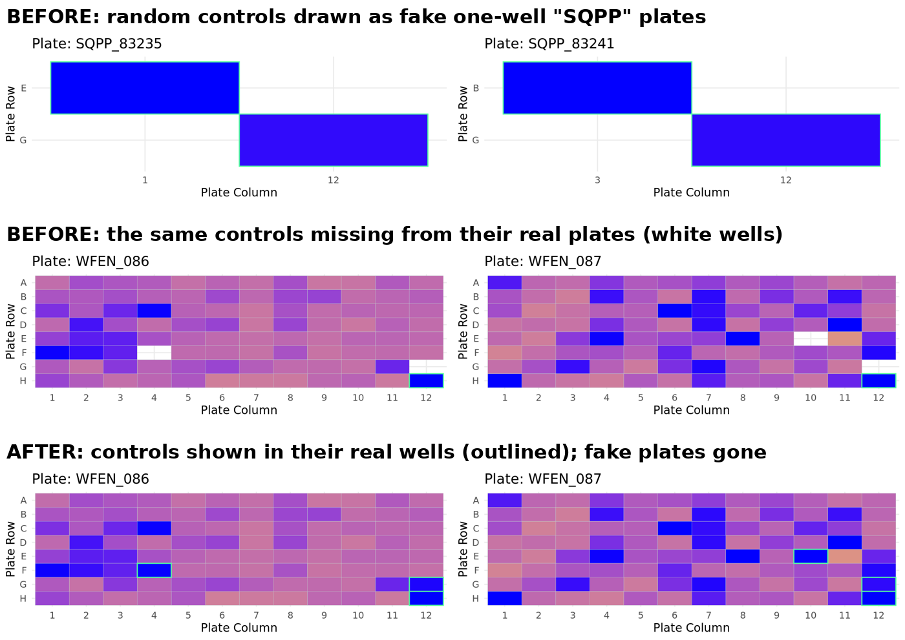
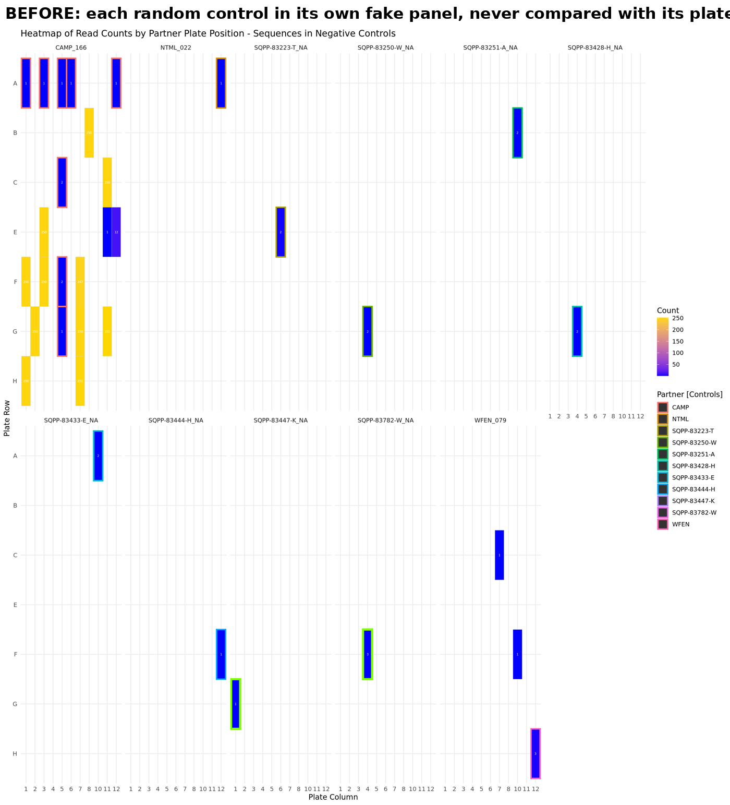
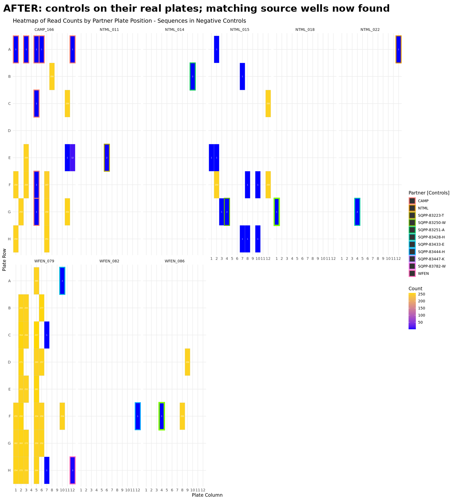
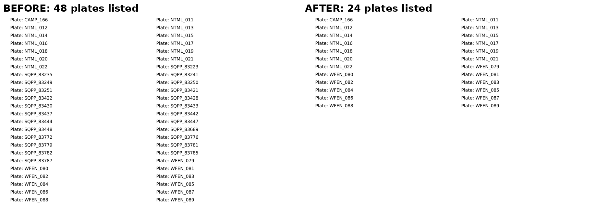

# Plate assignment fix for random controls and batch-labelled reports

Branch: `dev` (version 3.0 work). File changed: `QCBioscan_rerun.Rmd`.
Author: Lyndall Pereira. Tested on 17 Nov 2026.

## Summary

**QC results are unchanged.** This change only affects the plots in the HTML report:

- **Plate heatmaps.** Random negative and positive controls are drawn on their real partner plates. Before, they appeared on fake one-well "SQPP" plates, which left gaps in the real ones.
- **Contamination heatmaps.** Each random negative control is now compared with the samples on its own plate. Before, it was compared with nothing.
- **Report label.** The title includes the batch name. With an updated run command, the HTML file name does too.

On batch43_0, all 10 QC output CSVs are byte-for-byte identical before and after the change.

## The problem

Each partner plate has a random control well. In mBRAVE these controls are labelled with the lab's SQPP plate code instead of the partner plate, for example:

| Label | mBRAVE `Sample Plate ID` |
|---|---|
| `CONTROL_NEG_SQPP-83235-A_E1` | NTML_012 |
| `CONTROL_POS_SQPP-83235-A_G12` | NTML_012 |

The script works out the partner plate from the label:

```r
partner_plate = str_extract(Label2, "^[^_]+_[^_]+")    # -> "SQPP_83235"
```

so every random control became its own plate, "SQPP_83235". This had three effects:

1. **Fake plates in the plate heatmaps.** Each fake plate had only one or two wells. In batch43_0 the report drew 48 plates instead of 24 (Figure 4). They are sorted alphabetically, so they sit between the NTML and WFEN plates and at the end of the list.
2. **Gaps in the real plates.** The control wells were missing from their real plate and showed as white (Figure 1).
3. **The contamination search never checked random controls.** That search groups sequences by `Sample.Plate.ID`, built from the label as `"SQPP-83235-A_NA"`. Each random control was therefore alone in its group and never compared with the samples on its plate (Figure 2).

Separately:

- All reports were saved as `QCBioscan_rerun.html` with the title "BIOSCAN QC Report". When several are downloaded at once, there's no way to tell which batch each one is.
- The plate boxplot colours were shuffled at random on every run (`sample(pastel_colors_small)`), so the same partner could have a different colour in each report.

## The changes

`apply_platefix.py` makes all of these edits. It stops without writing anything if any edit doesn't match the script exactly.

| # | Where | What it does | Why |
|---|---|---|---|
| 1 | YAML header | Title becomes `BIOSCAN QC Report: <batch>` | Shows which batch the report is for |
| 2 | `partner_plate_assessment` | `subgroup <- pastel_colors_small` (no `sample()`) | Same colours for the same partners in every report |
| 3 | Stats table (after `Label2`) | For labels starting `SQPP`, `partner_plate` is taken from mBRAVE's `Sample.Plate.ID` when it looks like a plate (`NTML_012`). Otherwise it stays as before. The label-derived value is kept in `partner_plate_from_label`, and `internal_control` is set for Group "DNAP CONTROLS". | Puts random controls on their real plates. mBRAVE already records the plate, so nothing is guessed. |
| 3b | Same place | Writes `plate_assignment_<batch>.csv`: one row per well, with label, group, mBRAVE plate, plate from label, plate used, row, column, internal-control flag | So anyone can check which plate each well was put on |
| 4 | Before the negative-control histogram | For SQPP rows in `qc_AM`, `Sample.Plate.ID` is set to the real plate, and a new `partner_group` column holds the partner (NTML, WFEN…) | The contamination search now compares each random control with the samples on its own plate |
| 5 | Both contamination heatmaps | Control outline colour uses `partner_group` instead of `partner_plate` | The legend shows partners, not one entry per SQPP code |
| 6 | `heatmapPlate_cat` | `if (nrow(group_data) == 0) next` | Skips a plate with nothing to draw instead of drawing an empty panel |

**What stays the same:**

- categories, decisions and read thresholds;
- filtering, BOLD and portal outputs;
- the UMI-plate heatmaps, which already use the UMI plate and were correct;
- whole plates of lab negative controls (Group "DNAP CONTROLS", e.g. SQPP_42666–42669 in batch10). They are real 96-well blank plates and are still drawn; `plate_assignment` flags them as `internal_control`.

`partner_plate` in the sequence table (`qc_AM`) isn't changed, so tables that include it (for example the anopheles table and the samples to examine) stay as they are.

## Run command: batch in the file name

The file name is set by the command that renders the report, not by the Rmd itself. Add `output_file` to the render call in the run script:

```r
rmarkdown::render(
  input = "QCBioscan_rerun.Rmd",
  output_format = "html_document",
  output_file = paste0("QCBioscan_rerun_", Sys.getenv("batch_no"), ".html"),
  output_dir = Sys.getenv("output_path"))
```

This gives `QCBioscan_rerun_batch43_0.html`. Keeping "rerun" in the name means the flatfile build still recognises which script made the report.

## Testing

**Data.** Copies of the raw mBRAVE files in a test folder (`bip_qc_test`). Nothing in `mbrave_batch_data` or `bioscan_qc/code` was touched.

| Batch | Random SQPP control rows | Result |
|---|---|---|
| batch43_0 | 48 (24 negative, 24 positive) | All 48 moved to their mBRAVE plate. All 24 plates now have exactly 96 wells. No fake plates left. All 10 output CSVs identical. |
| batch10 | 384, but these are 4 whole plates of lab negative controls (DNAP CONTROLS, SQPP_42666–42669), not random controls | None moved (correct). All 10 output CSVs identical. These plates stay in the plate heatmaps as real 96-well plates. |

**CSVs compared byte for byte (batch43_0):**

- `qc_portal`
- `filtered_metadata`
- `BOLDfiltered_metadata`
- `all_arthropod_sequences`
- `conflicts`
- `retained_partners_percentage`
- `retained_sample_percentage`
- `retained_umi_percentage`
- `tar_nem_rot_ann`
- `wolbachia`

All identical.

**Plots compared:** all 49–73 images in each report were extracted and compared.

- Unchanged: positive/negative control statistics, primary/secondary assessment, retained-sample heatmaps, all UMI heatmaps.
- Changed as intended: the two per-plate heatmap sections (fake plates removed, gaps filled), the partner-plate contamination heatmap (controls on real plates), and the plate boxplots (colour only).

### Figure 1: plate heatmaps



**Before:**
- random controls appear as fake plates (top);
- the same wells are white on their real plate: WFEN_086 F4 and G12, WFEN_087 E10 and G12 (middle).

**After:** the controls are shown, outlined, in their real wells (bottom).

### Figure 2: contamination heatmap, before



Each random negative control has its own panel (`SQPP-83223-T_NA`, `SQPP-83250-W_NA`, …), with no samples from its plate to compare against.

### Figure 3: contamination heatmap, after



The same controls are on their real plates (NTML_011, NTML_014, WFEN_079, …), and samples on the same plate with a matching sequence (within 2 differences) are shown as possible sources.

For example, the WFEN_079 random control at A10 (2 reads) matches about 20 samples on that plate with about 250 reads each.

This check was always meant to run. Its results appear only in the HTML report, not in any CSV.

### Figure 4: plates listed in the report



batch43_0: 48 plates before (24 of them fake "SQPP" plates), 24 after.

## Review checklist

- [ ] `python3 apply_platefix.py QCBioscan_rerun.Rmd` reports `Patched`
- [ ] `job_platefix_final.sh`: dev HEAD vs patched dev on batch43_0, every CSV `SAME`
- [x] batch10 report checked: all 10 CSVs identical; the 4 lab control plates (DNAP CONTROLS) still drawn
- [ ] Run scripts updated with `output_file` (above)
- [ ] CHANGELOG entry added
